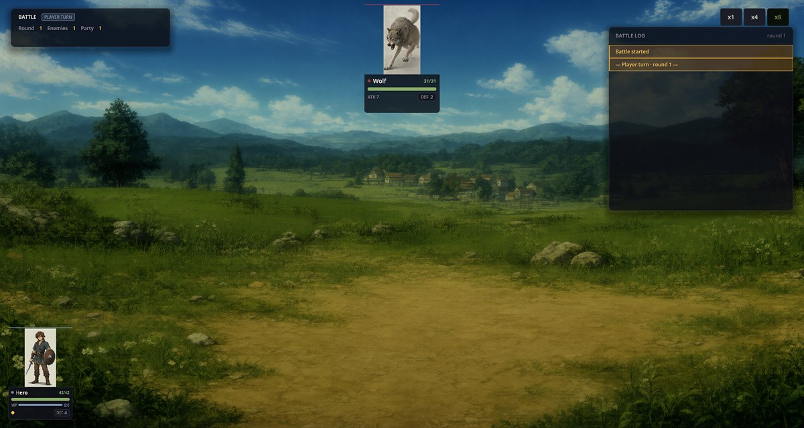
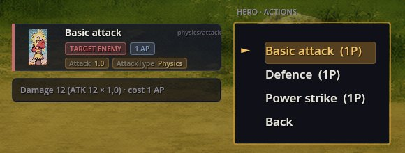
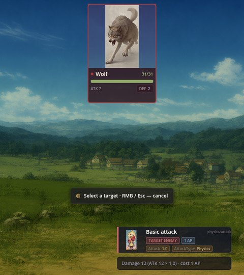
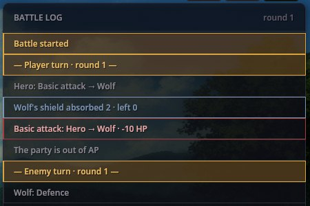

# FF Battle —— 指令菜单式战斗

FF Battle 是一套经典主机 RPG 风格的战斗系统：队伍在左下角，敌人在上方，还有一个指令菜单——Attack、Items、Defend、Escape。它是 RPG Plus 的战斗系统。战斗本身——发起、背景、胜利与失败画面、经验和掉落——来自 Turn Battle Base；FF Battle 决定的是玩家的战斗方式。

## 战斗画面

RPG Plus 的战士在村庄里遭遇一只狼：

- **卡牌。** 每个角色显示生命、攻击和防御（DEF 是优先吸收伤害的护盾）、魔力（若游戏有此设定），以及代表行动点的黄色圆点（AP）。
- **Battle 面板**——显示回合数、敌我双方剩余数量，以及当前轮到谁行动。
- **战斗日志**——记录每个动作及其结果，最新的在最下方。

## 一个回合的流程

1. **选择角色**——点击其卡牌，或按 **Enter**/**Space** 选中第一个还有行动点的角色。
2. **选择指令**——可用鼠标，或用 **W/S**、方向键加 **Enter**：
   - **Attack**——角色的战斗动作；
   - **Items**——背包中可使用的物品，每件 1 AP；
   - **Defend**——角色对自身的防御动作；
   - **Escape**——70% 概率逃跑；失败则该角色失去 1 AP。
3. **选择动作。** 菜单旁边的面板会显示动作卡及其效果：

4. **点击目标。** 屏幕上会出现「选择目标 · 鼠标右键 / Esc — 取消」的提示，敌人卡牌随之高亮：

队伍用完行动点后，轮到敌人行动；随后新回合开始，行动点也会恢复。

## 日志里写了什么

一次普通攻击和狼的回击之后：

英雄的攻击为 12。狼的护盾（2）先吸收了最初的 2 点并耗尽，因此狼损失了 10 点生命：31 → 21。随后狼使用 Defence，把护盾提升到 4 以迎接下一击。

## 动作类型

菜单里列出角色拥有的动作（参见 Characters Engine）。而以下几种基础类型由 FF Battle 自身处理：

- `Attack=1.5`——攻击伤害乘以该数值；优先被目标的护盾吸收；
- `Defence=4`——给队友加护盾；
- `Turn=2`——眩晕相应的回合数；
- 使用物品。

以公式书写的动作，比如 Classic RPG Rules 的 Power strike 或 Fireball，通过 Battle Formulas 生效；魔力消耗（`Cost=mp:4`）从角色的魔力中扣除。

## 出问题怎么办

1. **菜单打不开。** 该角色本回合的行动点已用完，或者当前是敌人的回合。
2. **Items 呈灰色。** 背包里没有可在战斗中使用的物品。
3. **技能没有任何效果。** 它的数值需要 Battle Formulas，或者它没有被标记为可在战斗中使用。
